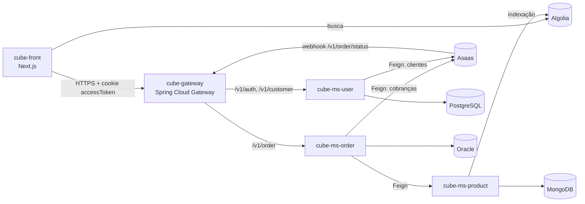

# cube-ms-order

Microsserviço de **pedidos e pagamentos** do **Cube**. Recebe o carrinho do cliente, busca os dados atuais dos produtos no `cube-ms-product`, gera a cobrança no **Asaas** e acompanha o pagamento até a confirmação via webhook.

## Ecossistema Cube



Todos os serviços e o gateway se registram no **cube-ms-eureka**.

| Repositório | Papel | Stack |
| --- | --- | --- |
| [cube-front](https://github.com/MatheysJ/cube-front) | Loja (interface web) | Next.js, Chakra UI, Algolia |
| [cube-gateway](https://github.com/MatheysJ/cube-gateway) | API Gateway e autenticação JWT | Spring Cloud Gateway |
| [cube-ms-eureka](https://github.com/MatheysJ/cube-ms-eureka) | Descoberta de serviços | Netflix Eureka Server |
| [cube-ms-user](https://github.com/MatheysJ/cube-ms-user) | Usuários e login | Spring Boot, PostgreSQL |
| [cube-ms-product](https://github.com/MatheysJ/cube-ms-product) | Catálogo de produtos | Spring Boot, MongoDB, Algolia |
| **cube-ms-order** (este repositório) | Pedidos e pagamentos | Spring Boot, Oracle, Asaas |
| [cube-admin](https://github.com/MatheysJ/cube-admin) | Painel administrativo (em planejamento) | - |

## Fluxo de um pedido

1. O front envia `POST /v1/order` com o meio de pagamento, o endereço e os itens (`id` e `quantity`). O gateway autentica o usuário e injeta `customer_id` e `asaas_customer_id`.
2. O serviço consulta o `cube-ms-product` (Feign, `POST /v1/product/list`) para obter nome, imagem e preço atuais de cada item. Se algum produto não for encontrado, o pedido é recusado com "o produto está fora de estoque".
3. O preço de cada item é o menor entre o preço padrão e o promocional, e o total do pedido é a soma de preço × quantidade.
4. Gera a cobrança no Asaas (`POST /v3/payments`) e recebe o link da fatura.
5. Salva o pedido no Oracle com status `PENDING`, o id da cobrança no Asaas e a `invoiceUrl`.
6. Quando o pagamento é confirmado, o Asaas chama `POST /v1/order/status` (webhook, autenticado no gateway) e o pedido passa para `PAID`.

## Endpoints

### Cliente — `/v1/order`

| Método | Rota | Descrição |
| --- | --- | --- |
| `GET` | `/v1/order` | Lista os pedidos do usuário (header `customer_id`) |
| `GET` | `/v1/order/{id}` | Detalha um pedido do usuário |
| `POST` | `/v1/order` | Cria um pedido (headers `customer_id` e `asaas_customer_id`) |
| `POST` | `/v1/order/status` | Webhook do Asaas: marca o pedido como `PAID` |

Corpo de `POST /v1/order`:

```json
{
  "billingType": "PIX",
  "address": { "...": "dados de entrega, opcional" },
  "items": [
    { "id": "<id do produto>", "quantity": 2 }
  ]
}
```

`billingType` aceita `PIX`, `BOLETO`, `CREDIT_CARD` e `UNDEFINED`.

### Administração — `/v1/admin/order`

| Método | Rota | Descrição |
| --- | --- | --- |
| `GET` | `/v1/admin/order` | Lista todos os pedidos |
| `GET` | `/v1/admin/order/{id}` | Busca um pedido por id |
| `POST` | `/v1/admin/order/test/asaas` | Endpoint de teste da integração com o Asaas (marcado com `TODO: Remove`) |

## Tecnologias

- Java 21
- Spring Boot 3.4.4, Spring Web e Bean Validation
- Spring Data JPA com **Oracle Database** (driver `ojdbc11`) e Flyway
- Spring Cloud 2024.0.1 (OpenFeign, Eureka Client e Config Client)
- Integração com a API do **Asaas** (ambiente sandbox por padrão)
- MapStruct 1.6.3 e Lombok
- Docker Compose (Oracle para desenvolvimento)

## Variáveis de ambiente

| Variável | Obrigatória | Descrição |
| --- | --- | --- |
| `ASAAS_API_KEY` | Sim | Chave de API do Asaas (enviada no header `access_token`) |
| `DB_USERNAME` | Não | Usuário do Oracle. Padrão: `cubeMsOrder`. |
| `DB_PASSWORD` | Não | Senha do usuário do Oracle (há valor padrão para desenvolvimento) |
| `EUREKA_URL` | Não | URL do Eureka Server |
| `EUREKA_INSTANCE` | Não | Hostname público com que o serviço se registra no Eureka |

O banco é esperado em `jdbc:oracle:thin:@//localhost:1521/ORCLPDB1`.

## Como executar

Pré-requisitos: JDK 21+, Docker e um Eureka Server acessível, além do `cube-ms-product` no ar para criar pedidos.

1. O `compose.yml` sobe um **Oracle Database Enterprise** (`container-registry.oracle.com/database/enterprise`) e executa o `init-app-user.sql`, que cria o usuário `cubeMsOrder` no `ORCLPDB1`. Essa imagem exige aceitar os termos e fazer login no Oracle Container Registry (`docker login container-registry.oracle.com`), e a primeira inicialização do banco é demorada. Como `spring.docker.compose.enabled` está ativo, o Spring Boot sobe o compose automaticamente ao iniciar a aplicação (ou use `docker compose up -d`). As credenciais do compose são apenas para desenvolvimento local.

2. Defina as variáveis e execute:

   ```bash
   export ASAAS_API_KEY="<sua chave do Asaas>"
   export EUREKA_URL="http://localhost:8761/eureka/"

   ./mvnw spring-boot:run   # no Windows: mvnw.cmd spring-boot:run
   ```

O serviço sobe em `http://localhost:8082`. As tabelas `orders` e `items` são criadas automaticamente (`ddl-auto: update`).

## Estrutura

```
src/main/java/com/cube/order
├── controllers/   # OrderController e AdminOrderController
├── services/      # OrderService / OrderServiceImpl
├── clients/       # Feign: Asaas (pagamentos) e Product (catálogo)
├── models/        # Order e Item (entidades JPA)
├── repositories/
├── mappers/       # MapStruct
├── dtos/          # Request, response e DTOs do Asaas
├── enums/         # PaymentMethod e códigos de erro
├── utils/         # Cálculo de preço e conversor de opções para JSON
└── exceptions/
compose.yml        # Oracle para desenvolvimento
init-app-user.sql  # Criação do usuário da aplicação
```

## Autor

Desenvolvido por [@MatheysJ](https://github.com/MatheysJ).
